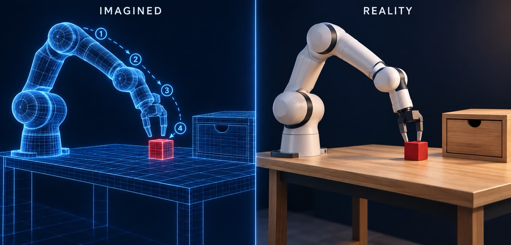
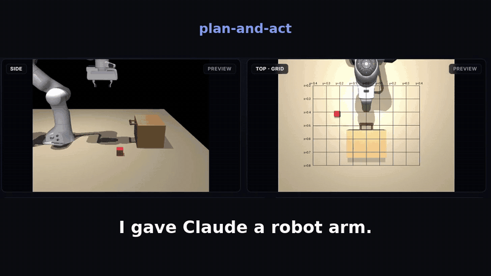
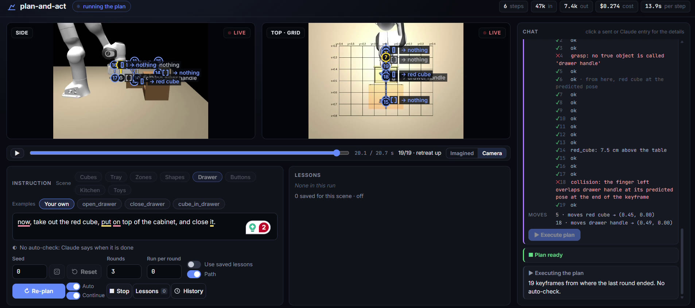

# plan-and-act

Claude controls a simulated Franka Panda arm in MuJoCo, through the Claude Code CLI.

## Setup

Needs Python 3.12, `uv` and a logged-in Claude Code CLI.

    uv sync
    ./scripts/fetch_assets.sh     # the robot arms
    ./scripts/fetch_objects.sh    # scanned objects for the kitchen and toys scenes

## Run

    uv run plan-and-act serve          # http://127.0.0.1:8780

Pick a scene and a robot, type an instruction, and press Plan to see Claude's plan as a 3D video. Then press Execute and Re-plan, or set the Auto switch to repeat plan, execute and re-plan until the auto-check passes or Claude says done. With Continue on, a re-plan starts where the last execution ended. Plan goes on, Reset starts over. After the first round, the Plan button goes on from the newest round on the page. With the same instruction, it re-plans (↻ Re-plan). With a new instruction in the box, it says Plan from here: Claude gets the new task in the same chat. The arm goes on from where it is now. Press Reset, or change the scene or the seed, to start a new chain and a new chat from the fresh scene. All rounds of one plan share one chat with Claude. The CLI keeps these chats under ~/.claude/projects/, and its own cleanup removes old ones. After that, a re-plan starts a new chat with a summary.

The Scene description box under the instruction is the scene text that Claude gets. Hints sets what fills it. Names only gives the object names and the fixed items without positions or sizes. Then Claude must find them in the images. Full gives the sizes and the positions of the fixed items. Edit the box as you like. A new Plan sends it, and every round of that plan keeps it.

Drag the Front image to look around with a free camera. Drag to orbit, and right-drag or Shift-drag to pan. Use the wheel to zoom, and W A S D Q E to move. Double-click goes back to the fixed camera. The free camera is for you only. Claude always gets the fixed cameras.

Run a task with a scripted solution, with no model:

    uv run plan-and-act scripted --scene tray --task all_in_tray --seed 2
    uv run plan-and-act scripted --scene cubes --task pick --robot ur5e

## Robots

The Robot list on the page picks the arm. The Franka Panda is the default. The other arms come from MuJoCo Menagerie, and the YAM Ultra (v2) comes from the I2RT SDK. An arm without a gripper gets a Robotiq 2F-85. `src/plan_and_act/sim/robots.py` lists the arms. Each entry gives the model file, the gripper bodies, the base position and the start point. The code finds the rest: the arm joints, the gripper actuator, the point between the fingertips and the open width. Claude gets the same actions for every arm, and the prompt names the arm, its base, its open width and its start point.

There are 18 arms:

- Franka Panda and FR3, Kinova Gen3, KUKA iiwa 14, Rethink Sawyer and Flexiv Rizon 4
- Universal Robots UR5e and UR10e, ROBOTIS OMY, UFACTORY xArm 7 and Lite 6
- AgileX Piper, ARX L5, I2RT YAM and YAM Ultra
- Trossen ViperX 300 S, WidowX 250 S and WidowX AI

A short 6-joint arm cannot point the gripper straight down over most of the table. These arms tilt the gripper up to 45 degrees where they must, and the prompt tells Claude so.

Each arm keeps its own saved lessons. Not every arm can do every task. A short arm cannot reach the far side of the table, and the Lite 6 gripper opens only 1.8 cm. The scripted solutions of the scenes fit the Panda.

If EGL fails, set `MUJOCO_GL=osmesa`.

## Test

    ./scripts/check.sh

## License

MIT. The assets are not in this repository:

- Robot models: [MuJoCo Menagerie](https://github.com/google-deepmind/mujoco_menagerie). Each model folder has its own license: Apache 2.0, MIT or BSD.
- YAM Ultra model: [I2RT SDK](https://github.com/i2rt-robotics/i2rt), MIT.
- Object scans: [Google Scanned Objects](https://research.google/blog/scanned-objects-by-google-research-a-dataset-of-3d-scanned-common-household-items/) (Downs et al., 2022), [CC-BY 4.0](https://creativecommons.org/licenses/by/4.0/).
- MJCF conversion: [mujoco_scanned_objects](https://github.com/kevinzakka/mujoco_scanned_objects) by Kevin Zakka, MIT.
